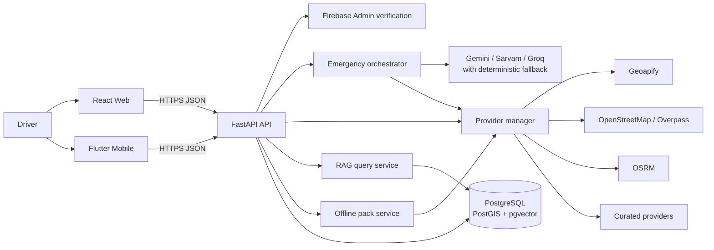
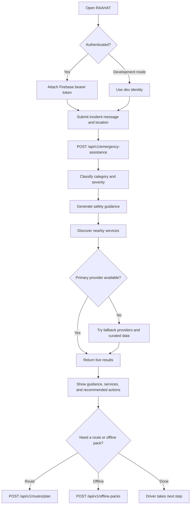
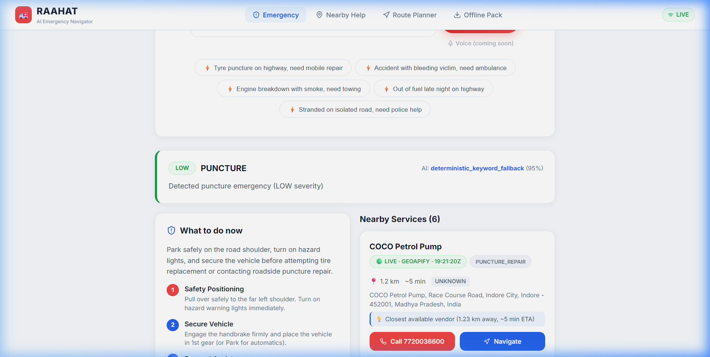
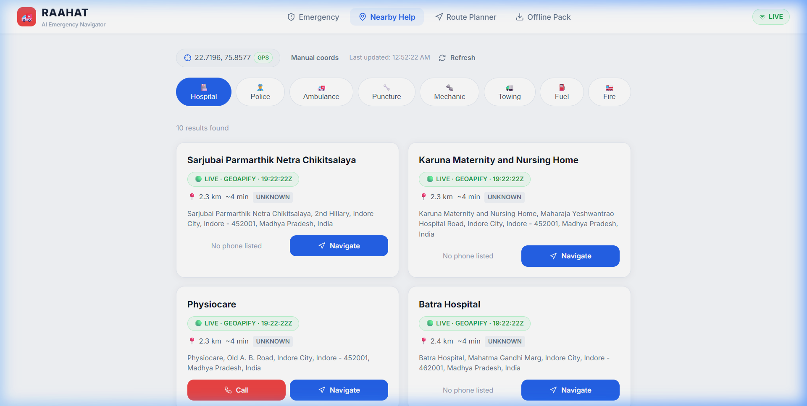
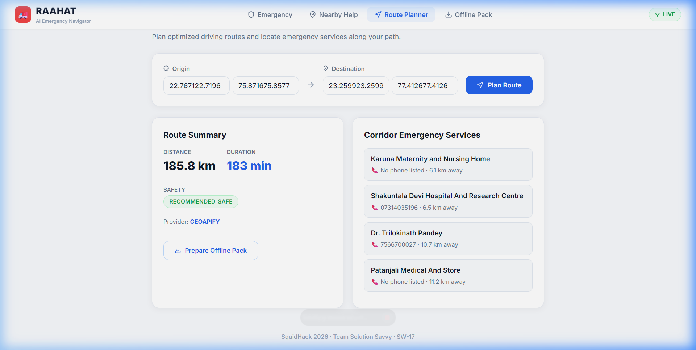

<div align="center">


# RAAHAT

### Roadside Assistance & Help Anytime Tool

AI-assisted emergency triage, nearby roadside services, safer route planning, and offline emergency packs for Indian highways.

[](https://fastapi.tiangolo.com/)
[](https://react.dev/)
[](https://flutter.dev/)
[](https://www.python.org/)
[](https://www.postgresql.org/)
[](https://render.com/)

<br>

**SquidHack 2026 · Team Solution Savvy · Problem Statement SW-17**

</div>

> **Mission:** turn a stressful highway emergency into a clear, calm, and actionable next step.

## Contents

- [Why RAAHAT](#why-raahat)
- [Features](#features)
- [How it works](#how-it-works)
- [Technology stack](#technology-stack)
- [Project structure](#project-structure)
- [Getting started](#getting-started)
- [Configuration](#configuration)
- [Using the application](#using-the-application)
- [API overview](#api-overview)
- [Deployment](#deployment)
- [Testing and quality](#testing-and-quality)
- [Roadmap](#roadmap)
- [Contributing](#contributing)
- [License and acknowledgments](#license-and-acknowledgments)

## Why RAAHAT

Highway incidents are difficult to handle when the driver is under pressure, far from a city, facing a language barrier, or dealing with unreliable connectivity. RAAHAT brings the first response into one web and mobile experience:

- Describe an incident in natural language, including Hindi/Hinglish or English.
- Receive severity classification, immediate safety guidance, and recommended actions.
- Find nearby hospitals, police, ambulances, mechanics, towing, fuel, and puncture services.
- Plan a route with emergency services discovered along the corridor.
- Generate a downloadable offline pack for a region or route.

The backend uses live providers when configured and can fall back through Geoapify, OpenStreetMap/Overpass, OSRM, and curated provider data. Set `USE_MOCKS=true` only when intentionally testing the mock provider.

## Features

| Area | Capability |
| --- | --- |
| 🚨 Emergency triage | Classifies incident category and severity, returns first-aid/safety guidance, and recommends next actions. |
| 🗺️ Nearby help | Searches for hospitals, police, ambulances, fire services, towing, mechanics, puncture repair, and fuel services. |
| 🛣️ Safe routing | Plans origin-to-destination routes and attaches nearby emergency services from sampled corridor points. |
| 📦 Offline readiness | Creates JSON emergency packs with provider data, emergency contacts, file metadata, and a SHA-256 checksum. |
| 🎙️ Voice assistance | Accepts transcript or audio payloads and sends the recognized incident through the same triage pipeline. |
| 🔐 Authentication | Supports Firebase ID-token verification in production and an explicit auth-disabled development mode. |
| 📡 Diagnostics | Exposes health, provider status, and recent request telemetry for operational visibility. |
| 📱 Multi-client UX | Includes a React/Vite web app and a Flutter mobile client sharing the FastAPI contract. |

### Current boundaries

- The voice endpoint currently returns triage data; `response_audio_base64` is not generated by the backend.
- Offline packs are held in process memory and are therefore not durable across restarts.
- The mobile client is present and wired for the shared API, but the web client is the primary documented local demo path.
- No open-source license file is currently tracked in the repository.

## How it works

### Architecture



### Primary emergency flow



## Technology stack

| Layer | Technologies |
| --- | --- |
| Web | [React 18](https://react.dev/), [TypeScript](https://www.typescriptlang.org/), [Vite](https://vitejs.dev/), React Router, Leaflet, Three.js, Lucide |
| Mobile | [Flutter](https://flutter.dev/), Dart 3.13+, Provider, Geolocator, Sqflite, Firebase Auth |
| API | [FastAPI](https://fastapi.tiangolo.com/), Pydantic v2, Uvicorn, HTTPX |
| AI and voice | Google Generative AI, Groq, Sarvam integration hooks, deterministic classification fallback |
| Geospatial | Geoapify, OpenStreetMap Overpass, OSRM, curated provider data |
| Persistence | PostgreSQL, PostGIS, pgvector, SQLAlchemy async, Alembic |
| Authentication | Firebase Admin SDK on the backend; Firebase Web SDK and Firebase Auth on clients |
| Quality | Pytest, pytest-asyncio, TypeScript compiler, Vite production build |
| Deployment | Render blueprint for the backend; Vercel SPA rewrite configuration for the web client |

## Project structure

```text
raahat-ai/
├── apps/
│   ├── web/raahat-ai-web-main/     # React/Vite web client
│   │   ├── src/                    # Pages, auth, API client, components
│   │   ├── public/image/logo.png   # Web logo
│   │   ├── package.json
│   │   └── .env.example
│   └── mobile/                     # Flutter client
│       ├── lib/                    # Screens, services, auth, location
│       ├── assets/images/logo.png
│       └── pubspec.yaml
├── backend/
│   ├── app/
│   │   ├── api/v1/                 # FastAPI route modules
│   │   ├── core/                   # Settings, security, database, telemetry
│   │   ├── providers/              # Live and fallback geospatial providers
│   │   ├── repositories/           # Database access
│   │   ├── schemas/                # Pydantic request/response models
│   │   └── services/               # Triage, routing, RAG, ranking
│   ├── alembic/                    # Migration configuration
│   ├── data/curated_providers.json
│   ├── tests/
│   ├── requirements.txt
│   ├── .env.example
│   └── DEPLOYMENT.md
├── RAG/                            # Emergency knowledge-base JSON documents
├── contracts/                      # API contract documentation
├── docs/screenshots/               # Verified UI screenshots
├── scripts/                        # RAG ingestion and verification scripts
├── render.yaml                     # Render backend blueprint
└── .gitignore
```

## Getting started

### Prerequisites

- Git
- Python 3.12.8 (see `backend/runtime.txt`)
- Node.js and npm
- Flutter SDK with Dart 3.13.1 or newer for the mobile client
- PostgreSQL with `postgis` and `vector` extensions for persistent production use

### 1. Clone the repository

```bash
git clone https://github.com/Santoshray-27/raahat-ai.git
cd raahat-ai
```

### 2. Run the backend

```bash
cd backend
python -m venv .venv

# macOS/Linux
source .venv/bin/activate

# Windows PowerShell
# .venv\Scripts\Activate.ps1

python -m pip install --upgrade pip
pip install -r requirements.txt
cp .env.example .env
uvicorn app.main:app --reload --host 0.0.0.0 --port 8000
```

The API is available at `http://localhost:8000`. Interactive documentation is available at [`/docs`](http://localhost:8000/docs) and [`/redoc`](http://localhost:8000/redoc).

For a local no-database smoke test, leave `DATABASE_URL` unset. The application is designed to boot in degraded no-DB mode; database-backed features require a reachable PostgreSQL instance.

### 3. Run the web client

Open a second terminal from the repository root:

```bash
cd apps/web/raahat-ai-web-main
npm install
cp .env.example .env
npm run dev
```

Open the URL printed by Vite, normally `http://localhost:5173`.

### 4. Run the mobile client

```bash
cd apps/mobile
flutter pub get
flutter run
```

The mobile app uses the Firebase and API settings in its source configuration. Configure the backend URL for the target device before testing on a physical device.

## Configuration

### Backend environment variables

Copy `backend/.env.example` to `backend/.env`. Values below are placeholders; never commit credentials.

| Variable | Purpose |
| --- | --- |
| `PROJECT_NAME`, `VERSION`, `API_V1_STR` | API metadata and route prefix. |
| `ENVIRONMENT` | `development` enables reload behavior; use `production` for deployment. |
| `USE_MOCKS` | Enables the mock provider when `true`; keep `false` for live/fallback behavior. |
| `GEOAPIFY_API_KEY` | Geoapify places and routing provider key. |
| `GEMINI_API_KEY`, `SARVAM_API_KEY`, `GROQ_API_KEY` | AI/voice provider credentials. |
| `LLM_PROVIDER_ORDER`, `LLM_PROVIDER_TIMEOUT` | Provider order and per-provider timeout behavior. |
| `FIREBASE_CREDENTIALS_PATH` | Path to a Firebase Admin service-account JSON file. |
| `FIREBASE_CREDENTIALS_JSON` | Inline Firebase Admin credentials for deployment platforms. |
| `AUTH_DISABLED` | `true` for local development identity; set `false` to require Firebase ID tokens. |
| `DATABASE_URL` | Async PostgreSQL connection string for persistence and pgvector RAG. |
| `CORS_ORIGINS` | Comma-separated web origins allowed by FastAPI CORS. |
| `RAG_CORPUS_DIR` | Directory containing emergency knowledge-base documents. |
| `RAG_EMBEDDING_MODEL`, `RAG_EMBEDDING_DIMENSION` | Embedding model and vector size. |
| `RAG_RETRIEVAL_TOP_K`, `RAG_RETRIEVAL_MIN_SCORE` | RAG result count and similarity threshold. |

For production database setup, create the required extensions before migrations:

```sql
CREATE EXTENSION IF NOT EXISTS postgis;
CREATE EXTENSION IF NOT EXISTS vector;
```

### Web environment variables

Copy `apps/web/raahat-ai-web-main/.env.example` to `.env`:

| Variable | Purpose |
| --- | --- |
| `VITE_API_URL` | Backend base URL, including `/api/v1`. |
| `VITE_FIREBASE_API_KEY` | Firebase Web SDK configuration. |
| `VITE_FIREBASE_AUTH_DOMAIN` | Firebase authentication domain. |
| `VITE_FIREBASE_PROJECT_ID` | Firebase project identifier. |
| `VITE_FIREBASE_STORAGE_BUCKET` | Firebase storage bucket. |
| `VITE_FIREBASE_MESSAGING_SENDER_ID` | Firebase messaging sender ID. |
| `VITE_FIREBASE_APP_ID` | Firebase Web app ID. |

When Firebase Web values are empty, the client displays the development auth path. Do not use that mode for production.

## Using the application

The web client exposes these routes:

| Route | Access | Purpose |
| --- | --- | --- |
| `/` | Public | Product landing page and emergency demo console |
| `/login` | Public | Firebase login or development auth |
| `/signup` | Public | Account creation |
| `/app` | Protected | Emergency dashboard and triage |
| `/nearby` | Protected | Nearby service directory |
| `/route` | Protected | Safe route planner |

Suggested demo flow:

1. Start the backend and web client.
2. Sign in through development auth or configure Firebase.
3. Submit an incident such as `My tyre got punctured on the highway near Indore`.
4. Review the severity, immediate guidance, recommended actions, and provider-sourced services.
5. Use **Nearby** to filter service categories or **Route Planner** to plan a corridor.
6. Generate an offline pack and download its JSON payload.

### Screenshots

The repository includes verified UI captures:

| Dashboard | Nearby services | Route planner |
| --- | --- | --- |
|  |  |  |

Additional captures are available in [`docs/screenshots`](docs/screenshots), including authentication, offline packs, police results, and critical-incident triage.

## API overview

Base URL: `http://localhost:8000/api/v1`

Successful responses use:

```json
{
  "success": true,
  "data": {},
  "meta": {},
  "error": null,
  "request_id": "uuid"
}
```

| Method | Endpoint | Auth | Purpose |
| --- | --- | --- | --- |
| `GET` | `/health` | No | Service and database health. |
| `GET` | `/providers/status` | No | Provider configuration and status. |
| `GET` | `/diagnostics` | No | Recent request telemetry. |
| `POST` | `/emergency-assistance` | Optional | Triage an incident and return guidance/services. |
| `GET` | `/services/nearby` | No | Query services by `lat`, `lng`, optional `radius_km`, `category`, and `limit`. |
| `POST` | `/services/search` | No | Search with a structured location and `service_types` list. |
| `POST` | `/routes/plan` | No | Plan a route from `origin` to `destination`. |
| `GET` | `/routes/geocode` | No | Geocode a location using query parameter `q`. |
| `POST` | `/offline-packs` | No | Create an in-memory offline pack from a bounding box or route ID. |
| `GET` | `/offline-packs/{pack_id}` | No | Read an offline pack manifest. |
| `GET` | `/offline-packs/{pack_id}/download` | No | Download the generated JSON pack. |
| `POST` | `/voice/assist` | No | Triage transcript/audio payloads with optional location. |
| `POST` | `/location/update` | No | Store the latest location for a user ID. |
| `POST` | `/actions/dispatch` | No | Initialize a dispatch action for a target provider. |
| `POST` | `/rag/query` | No | Run a pgvector-backed emergency knowledge search. |
| `GET` | `/users/me` | Required | Return the authenticated Firebase user profile. |
| `GET` | `/users/me/conversations` | Required | Return recent persisted conversations when a database is available. |

### Example: emergency triage

```bash
curl -X POST http://localhost:8000/api/v1/emergency-assistance \
  -H 'Content-Type: application/json' \
  -d '{
    "message": "My tyre got punctured on the highway near Indore",
    "language": "en",
    "location": {
      "latitude": 22.7196,
      "longitude": 75.8577
    }
  }'
```

The `data` object contains `incident`, `guidance`, `services`, `recommended_actions`, `ai`, and optional `limitations`/`conversation_id` fields.

### Example: nearby services

```bash
curl 'http://localhost:8000/api/v1/services/nearby?lat=22.7196&lng=75.8577&category=HOSPITAL&limit=5'
```

### Example: route planning

```bash
curl -X POST http://localhost:8000/api/v1/routes/plan \
  -H 'Content-Type: application/json' \
  -d '{
    "origin": {"latitude": 22.7196, "longitude": 75.8577},
    "destination": {"latitude": 23.2599, "longitude": 77.4126},
    "prefer_safe_corridors": true
  }'
```

For complete field definitions, see [`contracts/04_RAAHAT_API_CONTRACTS_INTEGRATION_GUIDE.md`](contracts/04_RAAHAT_API_CONTRACTS_INTEGRATION_GUIDE.md) and the generated FastAPI docs.

## Deployment

### Render backend

[`render.yaml`](render.yaml) defines the backend service:

- Root directory: `backend`
- Build: `pip install -r requirements.txt`
- Start: `uvicorn app.main:app --host 0.0.0.0 --port $PORT`
- Health check: `/api/v1/health`
- Runtime: Python 3.12.8

Create the required Render environment variables from the backend configuration table. In production, set `AUTH_DISABLED=false`, provide `DATABASE_URL`, configure `CORS_ORIGINS`, and add provider/Firebase credentials through the platform secret manager.

### Web deployment

The web app is a standard Vite build:

```bash
cd apps/web/raahat-ai-web-main
npm ci
npm run build
npm run preview
```

`vercel.json` contains the SPA rewrite needed for client-side routes. Set `VITE_API_URL` and Firebase Web variables in the deployment environment.

There is currently no active GitHub Actions workflow in the repository; CI/CD is not configured in source control.

## Testing and quality

### Backend tests

```bash
cd backend
pytest -v
```

Pytest is configured in `backend/pytest.ini` with `tests/` as the test path and async session support.

### Web verification

```bash
cd apps/web/raahat-ai-web-main
npm run build
```

This runs TypeScript compilation followed by the Vite production build. The repository also contains live verification notes in [`FINAL_CHECK.md`](FINAL_CHECK.md) and [`VERIFICATION.md`](VERIFICATION.md); those reports describe the environment and run in which they were produced.

## Roadmap

The following are proposed follow-ups, not promises of current functionality:

- Persist offline packs in PostgreSQL or object storage instead of process memory.
- Add automated CI for backend tests and the web build.
- Complete production telephony/Sarvam audio integration for outbound assistance.
- Add API contract generation and client SDK validation.
- Add deployment-specific mobile API configuration and release documentation.

## Contributing

1. Fork the repository and create a focused branch.
2. Make the smallest change that solves the issue.
3. Run the relevant backend tests and/or web build.
4. Update documentation and API contracts when behavior changes.
5. Open a pull request with a clear description, testing notes, and screenshots for UI changes.

Please avoid committing `.env` files, Firebase service-account keys, or other credentials.

## License and acknowledgments

No `LICENSE` file is currently tracked, so the project does not yet declare an open-source license. Add a license before external redistribution or reuse.

Built by **Team Solution Savvy** for **SquidHack 2026**:

- **Satwik Misra** — backend architecture, AI/RAG, LLM orchestration, and voice integration
- **Santosh Ray** — web frontend, API integration, deployment, and QA
- **Saanvi Gupta** — Flutter client, offline workflows, and field research

Useful references:

- [FastAPI documentation](https://fastapi.tiangolo.com/)
- [React documentation](https://react.dev/)
- [Flutter documentation](https://docs.flutter.dev/)
- [Firebase Authentication](https://firebase.google.com/docs/auth)
- [Geoapify documentation](https://apidocs.geoapify.com/)
- [PostGIS documentation](https://postgis.net/documentation/)
- [pgvector](https://github.com/pgvector/pgvector)
